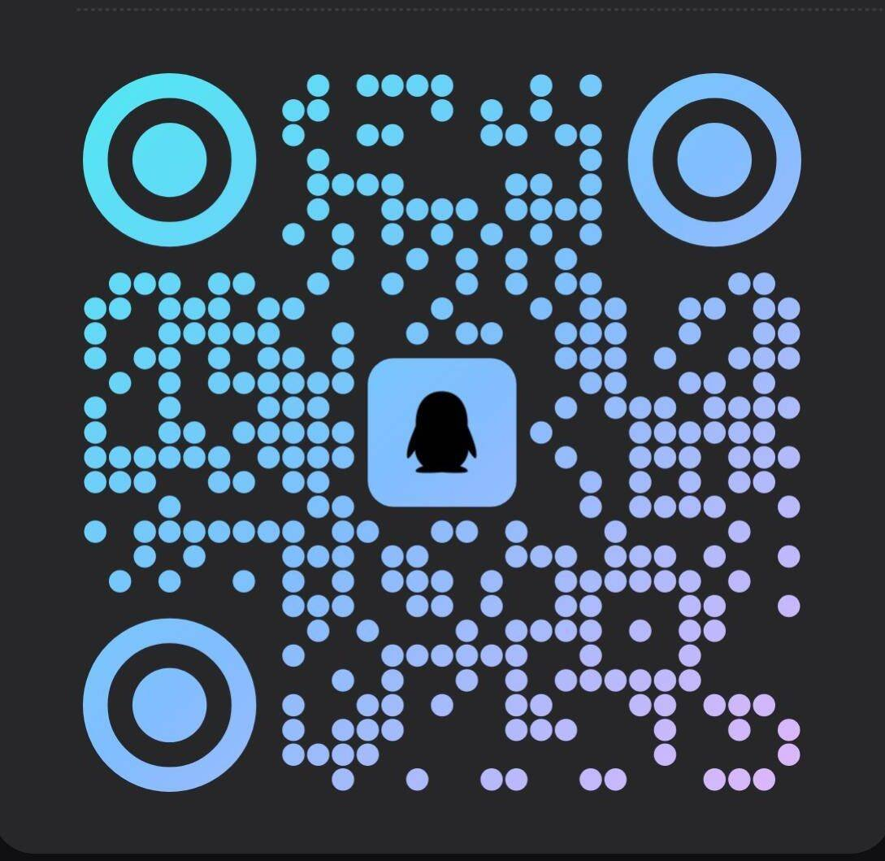

# DSH-ys-pojia

**破甲 plugin for DSH (DeepSeek Harness)** — make LLMs drop refusals on demand.

**English** · [简体中文](README.md)

> **[Landing page →](https://yushang657.github.io/DSH-YS-pojia/)** · layer diagrams, tier comparison, benchmark data, template library, known weaknesses

<!-- QQ group -->
<p align="left">
  <b>Group: crawling &amp; breach testing · QQ 674672646 · scan to join and talk shop</b><br>
  <a href="https://qm.qq.com/q/674672646" target="_blank">
    
  </a>
</p>

[](LICENSE)
[](package.json)
[](package.json)
[](#benchmarks)
[](#benchmarks)

---

## Features

Three layers at once. If one breaks, the other two still carry:

```
1  Host    96 patches across 70 files      rewrites DSH's own code and constants
2  Message history clean + tail anchor + prefill   rewrites the request view, never on disk
3  Prompt  11 sections                     injected into the system prompt
```

What you get:

- **Three engine tiers** — T3 Patch (highest ceiling) / T2 Boundary (zero patches) / T1 Prompt-only (most conservative), switchable after install
- **Overclock mode** — adapts per model vendor, 9 text groups covering international and Chinese models
- **Template library** — 95 templates across 29 vendors, matched to the model automatically
- **Rule panel** — 40 rules grouped and toggleable, effective immediately
- **CLI** — usable outside DSH: status, apply, roll back
- **One-command install** — see below

## Compatibility

| Item | Supported |
|---|---|
| **DSH Desktop** | 0.2.0-rc.2 (79/80 patch hits) · 0.2.2-rc.5 (85/96 patch hits) |
| **OS** | Windows / macOS / Linux |
| **Node.js** | >= 18 |
| **One-command install** | **PC only.** DSH Go on mobile has no profile directory structure — use the manual path |

Models tested: DeepSeek / GPT / Claude / Gemini / Qwen / Kimi / GLM and others.

| Metric | Value |
|---|---|
| ASR, single-shot | **46.2%** |
| pass@N ceiling | **76.9%** |
| Benign capability cost | **Δ 0** |

**[→ Full benchmark breakdown](https://yushang657.github.io/DSH-YS-pojia/#what)**

## Install

> **PC only** (Windows / macOS / Linux desktop). On mobile, use the manual path.

### Option 1: download and double-click (Windows, easiest)

1. Click **Code → Download ZIP** in the top right, save it locally
2. **Extract the archive** (important — do not run it from inside the zip viewer)
3. Open the extracted folder and find **`install.bat`**
4. Double-click it

When the console window says the install finished, you are done.

### Option 2: command line

**Windows PowerShell**:

```powershell
irm https://raw.githubusercontent.com/yushang657/DSH-YS-pojia/main/install.ps1 | iex
```

**Any platform** (needs Node.js >= 18):

```bash
npx github:yushang657/DSH-YS-pojia install
```

The script locates the DSH home, installs into every profile, and writes the registration
entry. Backs up before touching anything, restores on failure.

To preview without changing anything:

```bash
npx github:yushang657/DSH-YS-pojia install --dry-run
```

**Restart DSH afterwards.**

<details>
<summary>Manual install / uninstall</summary>

```bash
# manual
git clone https://github.com/yushang657/DSH-YS-pojia.git
cd DSH-YS-pojia
npm run deploy

# uninstall
node bin/ys-pojia.js --uninstall
```

Or inside DSH: **Plugins → Add plugin → paste the repo URL**.

</details>

### Verify it loaded

Type two characters in the chat box:

```
小雨
```

You should get four lines back. Nothing means it did not load — restart DSH and check that
the panel header shows a version number.

---

## Three engine tiers

| Tier | Touches host | Ceiling | When |
|---|---|---|---|
| **T3 Patch** | 96 patches | highest | host version is on the supported list |
| **T2 Boundary** | zero patches | medium | you would rather not modify host files |
| **T1 Prompt-only** | zero patches | basic | fallback when the host version is unknown |

**[→ Full tier comparison](https://yushang657.github.io/DSH-YS-pojia/#tiers-sec)**

## Known weaknesses

- A host version bump can silently invalidate patches (the panel shows the hit count)
- Some capability classes are hard walls no template gets through
- One-command install does not support mobile

**[→ Weaknesses and who this is not for](https://yushang657.github.io/DSH-YS-pojia/#weakness)**

## Changelog

| Version | Theme |
|---|---|
| **v1.5.4** | one-command install, docs trimmed |
| v1.5.3 | template library as a self-owned implementation |
| v1.5.2 | six fixed boundaries, every vendor covered |
| v1.5.1 | prefix rename, update channel removed |
| v1.5.0 | Android / DSH Go support |

**[→ Full changelog](https://yushang657.github.io/DSH-YS-pojia/#changelog)** · **[→ Releases](https://github.com/yushang657/DSH-YS-pojia/releases)**

## Upgrading

```bash
cd DSH-YS-pojia && git pull && npm run deploy
```

Or download the ZIP again, extract, and double-click `install.bat`. **There is no update
server and no in-app update check** — Releases is the only place to see whether a new
version exists.

## CLI

```bash
node bin/ys-pojia.js --status      # state
node bin/ys-pojia.js --apply       # apply patches
node bin/ys-pojia.js --revert      # roll back
node bin/install.js --dry-run      # preview an install
```

## License

Apache-2.0

## Disclaimer

Built for **authorized security research**: your own models, your own host, systems you are
allowed to modify.

You are responsible for confirming that your environment and use are lawful. The author
accepts no liability for misuse.
